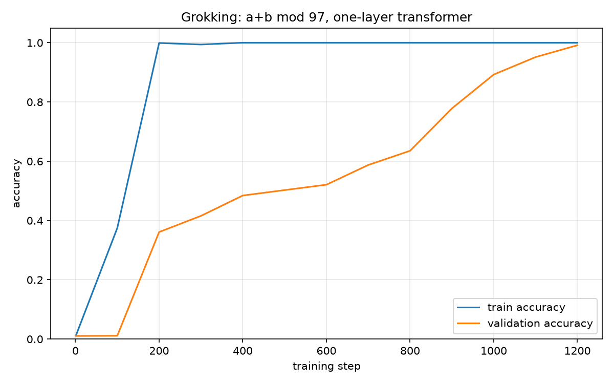

# Grokking reproduction

A tiny transformer that memorizes first and generalizes later,
reproducing Power et al., "Grokking: Generalization Beyond
Overfitting on Small Algorithmic Datasets"
(https://arxiv.org/abs/2201.02177).

## The result

One decoder layer, 225k params, trained on a + b mod 97 with half
the pairs held out. Train accuracy hit 100% by step 200.
Validation sat near chance, then climbed to 99.1% at step 1,200,
about 8 minutes on CPU. Memorization at ~200 steps,
generalization at 1,200: a 6x delay. That delayed jump is grokking.



Full write-up: `docs/grokking_2026-11-15.md`.

## Run it

```bash
python3 -m venv .venv
.venv/bin/python -m pip install torch --index-url https://download.pytorch.org/whl/cpu
.venv/bin/python -m pip install matplotlib
.venv/bin/python train.py            # full run, stops at val 99%
.venv/bin/python train.py --smoke    # 300 steps, checks it runs
.venv/bin/python plot.py             # writes runs/curve.png
```

## Files

- `train.py`: model, data, training loop, logging. One file, no
  framework magic, so every piece can be whiteboarded.
- `plot.py`: draws the train vs validation curve from the metrics.
- `runs/metrics.jsonl`: one JSON line per 100 steps.
